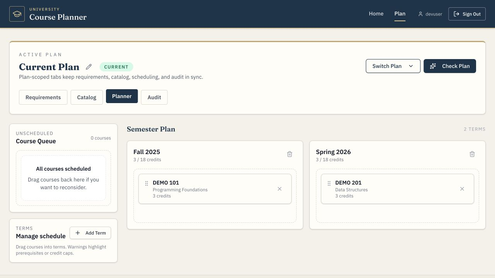
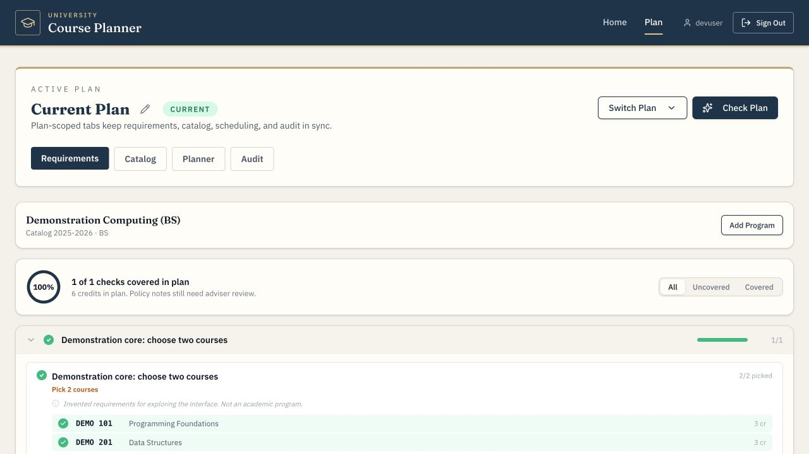
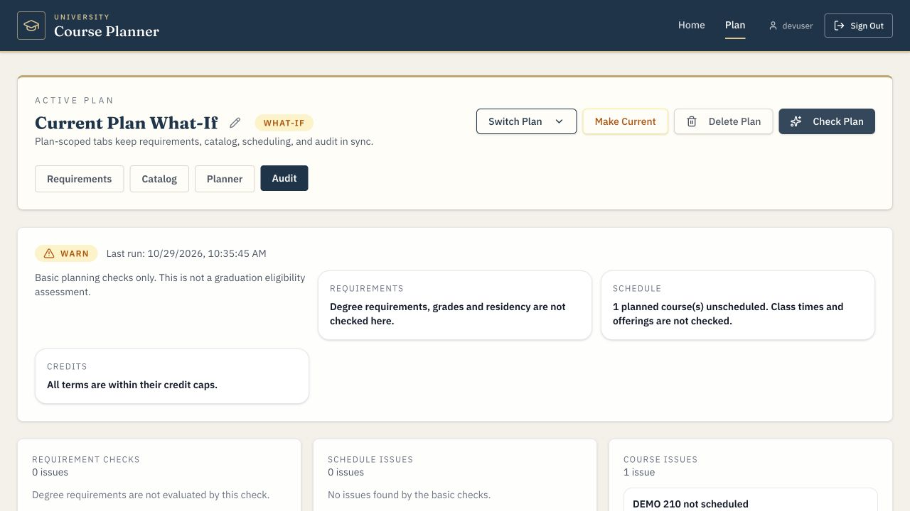

# University Course Planner

A full stack course planning application with catalog search, program requirements and semester scheduling.

I worked on this application as part of a university senior design team. This is my portfolio demo, with generic branding and an invented catalog so it can run independently of university services. I have continued improving the parser, planner behavior, tests and local setup. [Project background](docs/PROVENANCE.md) explains the team origins and the scope of this copy.

## Explore a study plan

Search courses by text, subject, level, credits or attributes, then add them to a plan. Program checklists show nested requirements and course choices for a selected catalog edition. The planner lets you drag courses into semesters, see semester credit totals and compare what-if copies without changing the original plan.



Prerequisite warnings highlight courses whose required courses are missing or scheduled too late. Requirement coverage updates as courses are selected. Plans and copied schedules persist in the browser across reloads.



**Check Plan** reports unscheduled courses and semesters above their credit caps. Its results clear when the plan changes. The requirements checklist and these basic checks support planning; they do not establish graduation eligibility. Grade rules, residency, class times and course availability still need separate review. Prerequisite warnings currently use flattened course codes, so alternatives and concurrent enrollment are not fully represented.



These are real screenshots of the running application using invented demonstration data. The [homepage screenshot](docs/screenshots/home-demo.png) shows the campus video and navy, ivory and gold theme.

## Run the demo

Install Docker with Compose, then run from the repository root:

```bash
cp .env.example .env
docker compose up --build
```

Open **http://localhost:8088**. The local profile signs in automatically as `devuser`. Add **Demonstration Computing (BS)** under Requirements and expand its two-course choice group. Try scheduling **DEMO 201** before **DEMO 101** to see a prerequisite warning, then put DEMO 101 in an earlier semester. Use **Switch Plan → + New What-If Plan** to copy the schedule.

The demo contains six invented courses, one program and simple prerequisite links. Both `local` and `demo` profiles must be active to load it. Inserts are idempotent, but use a dedicated database because the loader adds records to the configured database. Leave `demo` out of the profile list for an empty catalog. Live scraping is disabled by default.

Compose publishes only on loopback. Defaults are frontend `8088`, API `8080` and PostgreSQL `55432`; change the ports in `.env` if they are already in use. This local configuration automatically authenticates requests and is intended for a demonstration on your own machine. The full frontend and backend Docker builds have been verified.

### Native development

Use Java 21 and Node.js 24. The Maven Wrapper and npm lockfile are included. Start only PostgreSQL with Compose, then launch the backend:

```bash
# From the repository root
cp .env.example .env  # Only if you have not created it already
docker compose up -d db
cd backend
set -a
. ../.env
set +a
./mvnw spring-boot:run -Dspring-boot.run.profiles=local,demo
```

In a second terminal:

```bash
cd course_planner_frontend
npm ci
npm run dev
```

Open the Vite URL, normally **http://localhost:5173**. If you change the native API port, set `SERVER_PORT` when starting Java and `COURSE_PLANNER_API_URL=http://127.0.0.1:YOUR_PORT` when starting Vite.

## Implementation

| Part | Technologies |
| --- | --- |
| Interface | React 19, TypeScript, Vite 7, Tailwind CSS, dnd-kit |
| API | Java 21, Spring Boot 3.5, Spring Security, Spring Data JPA |
| Database | PostgreSQL 16, Flyway, JDBC login sessions |
| Catalog processing | jsoup, prerequisite normalization, requirement trees |

`backend/` contains the API, database migrations and catalog processing. `course_planner_frontend/` contains the interface and browser plan store. Plans use local storage and do not sync between devices or accounts. Clearing site data removes saved plans.

I focused the portfolio improvements on defects that affect real planning: copied schedules losing semester references, requirement choices being counted incorrectly, missing prerequisite details and parser policies being lost or attached to the wrong track. The original review resolved 16 failing parser snapshots. For this public copy, I replaced the university-derived pages with 30 independently authored synthetic cases that compare complete expected trees. [Parser testing](docs/PARSER_REVIEW.md) explains their specification and coverage.

`tools/bulletin_ai/` contains optional parser review and local model utilities. They are separate from the application and are not required for the demo. The campus background uses licensed footage by David Pickup through Pexels. [Media credits](docs/MEDIA.md) record the source, license and preparation steps.

## Validation

The [GitHub Actions workflow](.github/workflows/ci.yml) is configured to run frontend tests, lint and a production build; the full Java/PostgreSQL test suite and API packaging; and Python tooling checks. The backend uses Java 21 and Maven. Python 3.12 is used for the optional utilities and test-report verification, not for the API. Nine Python validation tests check the synthetic specification and failure handling in the report verifier.

```bash
cd course_planner_frontend
npm ci
npm test
npm run lint
npm run build

# From the repository root, in another shell
cd backend
./mvnw --batch-mode --no-transfer-progress clean verify
cd ..
python3 scripts/verify_backend_reports.py
```

The exported frontend has **18 passing tests**, clean lint and a successful production build. The backend has **79 passing tests and one skipped manual export utility**, including all 30 exact synthetic parser fixtures and database integration tests. Docker must be available for the PostgreSQL tests. CI requires Docker and rejects missing or unexpectedly skipped application tests; the manual export utility is the only allowed skip.

The frontend build reports a roughly 671 kB JavaScript chunk. Live university authentication, external scraping and production deployment have not been verified. [Testing notes](docs/TESTING.md) describe the checks and remaining limits.

## Author and project background

**Tyler Daley** · Portfolio maintainer

This began as a university team project, with instructor-provided project scaffolding. I have permission to share the team-written code in an individual GitHub portfolio copy. This copy features my work without claiming that I wrote every part of the original application. I have kept the original source and team Git history in a separate local archive.

This is a clean export with one import commit. Instructor templates, historical catalog snapshots and the original Git objects are excluded. The demo catalog, legacy prototype examples and parser fixtures are invented. I used AI assistance during portfolio preparation and verified the resulting changes locally. No source-code license has been selected. [Third-party notices](THIRD_PARTY_NOTICES.md) and [project background](docs/PROVENANCE.md) record attribution and the basis for the included material.
